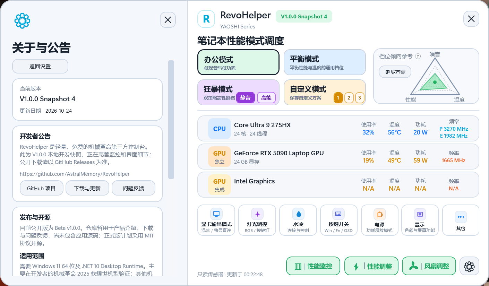
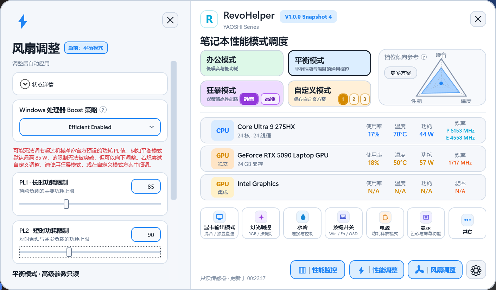

# RevoHelper

轻量、免费且开源的机械革命笔记本第三方控制台。把性能、风扇、灯光、水冷和常用设备设置集中在一起，在官方拥有的功能基础上拓展更多功能，性能开销更低、启动更快。

**当前公开版本：V1.0.0 正式版

## 产品预览

**以下为产品界面预览**，

<table>
  <tr>
    <td align="center"> 主界面</td>
    <td align="center"> 性能参数控制界面</td>
  </tr>
</table>

## 可以做什么

### 当前公开 Beta

- **性能调度与功耗调整**：切换办公、平衡、狂暴和自定义模式；在机型允许的范围内调整 CPU 功耗上限与频率，而不必总是更换整个性能档位。
- **风扇与散热**：查看风扇曲线，在支持的自定义模式下调整风扇；连接并控制蓝牙水冷。
- **硬件状态**：查看 CPU / GPU 的温度、使用率、功耗和频率。
- **灯光与常用设置**：集中控制支持的键盘、灯带、LOGO 和水冷灯光，以及显卡输出、刷新率、按键开关和电池保护模式等。
- **日常使用**：支持系统托盘和开机启动；可以与官方控制台共存，不会停用或禁用它及其后台服务。

具体可用项目由机型与固件决定，不代表每台电脑都具备以上全部功能。

### V1.0.0 正式版准备中

- **性能监控横条**：集中显示 FPS 与 CPU / GPU 状态；可拖动、置顶、锁定位置，不向游戏注入代码。
- FPS 默认跟随前台程序，也可手动添加并固定目标；没有有效数据时显示 `FPS —`。
- 新增深色模式，完善英文界面，调整字体与信息层级，统一左侧设置面板。
- 完善参数恢复与切换流程，保护用户已有的处理器限制。

以上为开发预览，最终提供的功能与更新内容以正式发布说明为准。

## 下载与运行

1. 前往 [Releases](https://github.com/AstralMemory/RevoHelper/releases)，下载对应版本的运行包；当前公开测试包为 `RevoHelper-v1.0.0-Beta.zip`。
2. 解压后运行 `RevoHelper.exe`，建议以管理员身份运行。无需安装 RevoHelper 本体。
3. 系统需要 **Windows 11 64 位**和 [.NET 10 Desktop Runtime（桌面运行时）](https://dotnet.microsoft.com/zh-cn/download/dotnet/10.0)。若提示缺少运行库，请选择 **Desktop Runtime**，而不是普通 Runtime。

运行包内的 `先阅读我-README.txt` 提供使用说明，`Third-Party.txt` 集中列出第三方组件信息。每个版本具体改了什么，请查看对应 Release 的更新日志。

## 机型支持

**部分机型已验证支持，具体功能以机型实际支持为准。**

开发与实测主要基于机械革命 2025 款耀世 Intel 机型，也已收到翼龙 15 Pro（Ryzen 7 8845H + RTX 4060）用户的部分功能正常使用反馈。这不等于全部 AMD 机型、全部 CPU 调节项目或所有电池功能均已验证。

不能只凭 CPU / GPU 型号判断完整兼容性；同系列不同年份、固件也可能有差异。欢迎反馈“哪台机型的哪个功能正常／异常”，帮助补充实际支持情况。

## 使用前请留意

- **与官方控制台共存**：两边同时修改同一设置时，以电脑实际生效的结果为准。
- **风扇曲线**：官方的预设通常无法调整风扇曲线，所以仅作参考；需要修改时请使用支持的自定义模式。
- **电池保护**：官方保护模式与“任意指定充电百分比上限”不是同一功能，不承诺所有机型都支持自定义限充。
- **显卡输出切换**：请先保存工作，再按提示重启；RevoHelper 不会强制重启电脑。
- **参数调整**：功耗与频率受机型限制，超频可能导致不稳定。手动 CPU 频率限制在程序运行期间生效，正常退出时恢复。
- **水冷启动组件**：BootWater 已内置；只有需要登录前连接水冷并主动点击“安装／修复”时，才会在系统目录部署辅助组件。

## 开发与开源

开发与维护：[AstralMemory](https://github.com/AstralMemory)。

本项目采用 **Vibe Coding** 开发方式：代码主要由 AI 辅助编写，开发者负责产品逻辑、方案与改动审批、UI 设计、实际测试和迭代维护。

程序免费使用。V1.0.0 应用源码已在本仓库公开，自有代码采用 [MIT 许可证](./LICENSE)，第三方组件遵循各自许可证，详见 [第三方声明](./THIRD_PARTY_NOTICES.md)。

开发者可直接浏览 [应用源码](./src)，构建、测试与目录说明见 [BUILDING.md](./BUILDING.md)。普通用户请下载 Release 中的 `RevoHelper-v1.0.0.zip` 运行包；`RevoHelper-v1.0.0-source.zip` 及正式版下 GitHub 自动生成的 “Source code” 压缩包用于获取源码，不是运行包。

## 反馈与交流

欢迎到 [GitHub Issues](https://github.com/AstralMemory/RevoHelper/issues) 或[视频评论区](https://www.bilibili.com/video/BV1gDHv6rE4K/)反馈。建议附上：

- 机型与年份、CPU / GPU 型号。
- RevoHelper 版本与 Windows 版本。
- 使用的是哪个功能，预期结果与实际结果。
- 能复现时的操作步骤，必要时附截图。

正常使用的反馈同样有帮助；反馈电池保护时，请说明所选模式、实际电量和是否停止充电。无需上传包含个人信息的完整系统报告。
